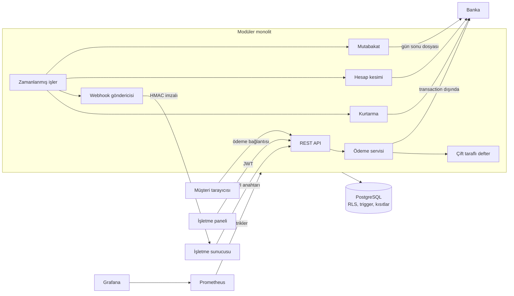

# Kasa

[](https://github.com/Fatihbk67/Kasa/actions/workflows/ci.yml)

Çok kiracılı (multi-tenant) ödeme altyapısı platformu. İşletmeler API anahtarıyla sisteme bağlanır, ödeme alır, iade yapar ve kazançlarını çeker. Her para hareketi çift taraflı muhasebe defterine (double-entry ledger) yazılır.

> Eğitim ve portföy projesidir. Gerçek kart verisi işlemez; banka tarafı simüle edilir.

**Canlı demo:** [kasa-rpb3.onrender.com](https://kasa-rpb3.onrender.com). Ücretsiz sunucu uykudaysa ilk açılış bir dakikadan uzun sürebilir. Kayıt olurken gerçek e-posta veya başka yerde kullandığınız bir parola girmeyin.

## Mimari



## Ölçülen performans

Tek dizüstü bilgisayarda (Intel i7-13650HX, 16 GB RAM) yük istemcisi, uygulama ve PostgreSQL aynı makinede çalışırken 30 saniyelik ölçümler. Bağlantı havuzu varsayılan 10 bağlantıdır, kalıcı commit (`synchronous_commit=on`) açıktır. Bir akış provizyon, tahsilat ve okumadan oluşur; tahsilat defter kaydı ve webhook kuyruğunu da yazar.

| Senaryo | Akış/sn | Provizyon p95 | Tahsilat p95 | Beklenmeyen yanıt |
|---|---|---:|---:|---:|
| 50 eşzamanlı istemci, 20 işletme | 879 | 36 ms | 43 ms | 0 |
| 50 eşzamanlı istemci, tek işletme | 577 | 50 ms | 69 ms | 0 |

Tek işletmede verimin düşmesi beklenen bir durumdur: aynı bakiye satırı ve denetim zinciri kilitlendiği için tahsilatlar sıraya girer. Bu, tutarlılığın bilinçli bedelidir. Hash zincirli denetim günlüğü eklenmeden önceki ölçüm çok işletmeli senaryoda 1.116 akış/sn idi, yani bedeli yaklaşık %8'dir.

Ölçüm sonunda her işletmenin bakiyesi istemcinin bağımsız hesabıyla kuruşu kuruşuna eşleşti. Mutabakat 26.410 akışın ürettiği 26.669 banka satırının 26.667'sini eşleştirdi; kalan iki fark, demo verisine bilerek konan banka hatalarıdır.

Simüle bankanın kayıtları da aynı PostgreSQL'e yazılır. Banka bellekteyken çok işletmeli senaryo 1.025 akış/sn ölçülmüştü, yani kalıcılığın bu ortamdaki bedeli yaklaşık %14'tür. Gerçek bir bankanın disk yazmaları bizim veritabanımıza yük bindirmez, ama ağ gecikmesi ekler.

Her senaryo temiz veritabanında ölçüldü. Banka bellekteyken tek işletme senaryosu, 20 işletmeli ölçümün bıraktığı veriler üzerinde tekrarlanınca 597'den 496 akış/sn'ye düşmüştü. Veri büyüdükçe hız kaybı olduğunu gösteriyor; nedeni henüz incelenmedi.

Sınırlar: Banka simüle edildiği için gerçek ağ gecikmesi yoktur. Rakamlar üretim kapasitesi değildir; sistemin bu makinedeki davranışını gösterir. Yeniden üretmek için sunucu çalışırken:

```bash
java -Djdk.net.unixdomain.tmpdir=backend/target load-test/LoadTest.java http://localhost:8080 50 30 20
```

## Çözülen mühendislik problemleri

- **Para kaybolmaz:** Her kayıtta borç ve alacak toplamı eşittir. Bu kural yalnızca uygulamada değil, veritabanında da zorunludur.
- **Geçmiş değiştirilemez:** Defter kayıtları güncellenemez ve silinemez. Hatalar ters kayıtla düzeltilir.
- **Çift işlem olmaz:** Aynı istek eşzamanlı olarak tekrar gönderilse bile idempotency anahtarı sayesinde bir kez işlenir.
- **Bakiye aşılamaz:** Eşzamanlı para çekme istekleri satır kilitleriyle sıraya girer. Hesaplar sabit sırada kilitlendiği için deadlock oluşmaz.
- **Tutarsızlık yakalanır:** Mutabakat sorgusu, saklanan bakiyeleri defter kayıtlarının toplamıyla karşılaştırır.
- **Kiracılar birbirinin verisini göremez:** İzolasyonu PostgreSQL Row Level Security uygular. Bir sorguda `tenant_id` filtresi unutulsa bile başka işletmenin verisi dönmez; kiracı bağlanmamışsa hiçbir satır görünmez.
- **Uygulama en az yetkiyle çalışır:** `kasa_app` rolü defter kayıtlarını değiştiremez. Bu rol RLS'i aşabilecek yetkilere sahipse uygulama hiç başlamaz.
- **Kimlik bilgileri korunur:** Parolalar BCrypt ile saklanır. API anahtarlarının yalnızca SHA-256 özeti tutulur ve anahtarın tamamı bir kez gösterilir. Sızan bir API anahtarı yeni anahtar üretemez.
- **Banka yanıt vermese de para kaybolmaz:** Her banka çağrısından önce işlem `PENDING` olarak kaydedilir. Zaman aşımında sonuç tahmin edilmez; kurtarma işi bankaya sorup işlemi sonuçlandırır.
- **Banka beklenirken veritabanı bağlantısı tutulmaz:** Akış üç adımdır: işlemi kaydet, transaction dışında bankayı çağır, sonucu kaydet.
- **Capture ve void yarışamaz:** Satır kilidi ve "ödeme başına tek `PENDING` işlem" kısıtı, aynı anda tek banka çağrısına izin verir.
- **Geçersiz durum geçişi imkânsızdır:** Örneğin `CAPTURED` bir ödeme yeniden `AUTHORIZED` olamaz. Bu kuralı veritabanı trigger'ı uygular.
- **Kart numarası sisteme giremez:** API yalnızca token kabul eder.
- **Bildirim kaybolmaz:** Webhook, ödeme sonucuyla aynı transaction'da kuyruğa yazılır (transactional outbox). Teslim edilemezse üstel geri çekilmeyle yeniden denenir.
- **Birden çok sunucu aynı bildirimi almaz:** `FOR UPDATE SKIP LOCKED` ile her gönderici farklı satırları alır. Gönderici çökerse lease süresi dolunca teslimat başkası tarafından devralınır.
- **Sahte bildirim ayırt edilir:** Her webhook, zaman damgasıyla birlikte HMAC-SHA256 ile imzalanır.
- **Webhook URL'si iç ağa saldırı aracı olamaz (SSRF):** Özel ağ, loopback ve bulut metadata adresleri hem kayıtta hem her gönderimde engellenir; yönlendirmeler izlenmez.
- **İşletmeye iki kez ödeme yapılmaz:** Bir işlem yalnızca tek bir canlı toplu ödemeye girebilir ve işletme başına günde tek ödeme oluşur. Bu kuralları veritabanı kısıtları uygular, iş aynı anda birden çok sunucuda çalışsa da geçerlidir.
- **Reddedilen ödemede para kaybolmaz:** Para önce "yolda" hesabına alınır. Banka reddederse tutar ve kalemler geri döner, sonraki çalıştırma yeniden dener.
- **Parola denemeleri yavaşlatılır:** Giriş, kayıt ve herkese açık ödeme uçlarında istek sınırı vardır; aşılınca `429` ve `Retry-After` döner. Sayaçlar sunucu başınadır, birden çok sunucuda ortak depo gerekir.
- **Sistem gözlemlenebilir:** Sonucu bilinmeyen banka işlemleri, webhook kuyruğu ve mutabakat farkları Prometheus metriği olarak yayımlanır. Metrik ucu yalnızca yönetici token'ıyla açılır.
- **Yetki değişikliği anında geçerli olur:** İmzalı token geri alınamaz, bu yüzden rol ve erişim her istekte veritabanından okunur. Çıkarılan üye bir sonraki istekte dışarıda kalır; parola değişince diğer oturumlar kapanır.
- **İşletme sahipsiz kalamaz:** İki sahip aynı anda birbirinin yetkisini alsa bile satır kilitleri sayesinde biri sahip kalır.
- **Geçmişle oynanırsa anlaşılır:** Denetim günlüğü değiştirilemez ve hash zinciriyle bağlıdır. Süper kullanıcı yetkisiyle yapılan bir değişiklik veya silme bile zincir doğrulamasında yakalanır. En yeni kayıtların silinmesini fark etmek için son hash'in veritabanı dışında saklanması gerekir; bu henüz yok.
- **İtiraz, ödeme kesintisini kilitlemez:** Banka parayı geri alınca işletmenin bakiyesi eksiye düşebilir. İtiraz hareketleri de ödeme işlemi olduğu için bir sonraki hesap kesiminden düşülür, banka dosyasıyla da otomatik karşılaştırılır.
- **Aynı para iki kez geri verilmez:** İtirazdaki tutar iade edilemez, iade edilen tutara itiraz açılamaz. İkisi aynı anda gelse bile satır kilidi sıraya koyar, veritabanı kısıtı da toplamı tahsilatla sınırlar.
- **Son dakika kanıtı ezilmez:** Süre dolumu işi bir itirazı listeledikten sonra kanıt gelirse, iş durumu kilit altında yeniden okur ve itirazı kaybettirmez.
- **Son kontenjan bir kez satılır:** 20 kişi aynı anda son yeri ödemeye çalışsa da tek çekim olur. Kontenjan sayaçta tutulmaz, oturumlardan sayılır; yarıda kalan bir ödeme yeri kalıcı olarak kapatamaz.
- **Kişisel veri silinebilir, mali kayıt kalır:** Müşteri silinince ad ve e-posta boşaltılır, ödemeler kişiyle bağlantısız olarak durur. Değiştirilemeyen denetim günlüğüne müşteri bilgisi hiç yazılmaz, yoksa silinemezdi.
- **Ziyaretçi müşteri bilgisini değiştiremez:** Herkese açık formda var olan bir e-posta girilirse kayıtlı ad korunur.
- **Yeniden başlatma bankayı unutturmaz:** Simüle banka da kayıtlarını veritabanında tutar. Kapatmadan önce alınan provizyon, açılınca tahsil edilebilir ve mutabakat eşleşir. Aynı işlem kimliğiyle gelen eşzamanlı çağrılar kilit sayesinde parayı bir kez hareket ettirir.
- **Bir dönem iki kez faturalanmaz:** Abonelik başına dönem başına tek fatura kuralını veritabanı uygular, birden çok iş aynı anda çalışsa da geçerlidir.
- **Tahsilat yarıda kesilirse kart ikinci kez çekilmez:** Her deneme, sonucu kesinleşene kadar numarasını ve kartını korur. Sunucu çökse bile aynı idempotency anahtarı aynı ödemeyi döndürür, yeni ödeme başlamaz. Kart bu arada değişse de bekleyen deneme eski kartla sonuçlanır.
- **Ay sonu kaymaz:** 31 Ocak'ta başlayan abonelik 28 Şubat'ta, sonra 31 Mart'ta yenilenir. Her dönem bir öncekinden değil başlangıç tarihinden hesaplanır.
- **Plan değişikliği hakkaniyetlidir:** Kalan süreye göre kuruş hesabı `BigInteger` ile yapılır, çünkü tutar çarpı saniye `long` sınırını aşabilir. Ucuz plana geçişte fark karta iade edilmez, sonraki faturadan düşülür.
- **Parola çalınsa da hesaba girilemez:** İki adımlı giriş RFC 6238 ile yazıldı. Bir kod iki kez kullanılamaz, aynı kod aynı anda gelse de tek istek geçer. 10 hatalı denemede hesap 15 dakika kilitlenir; sayaç veritabanında olduğu için yeni giriş denemesi veya sunucu değişimi sıfırlamaz.
- **Geri okunması gereken sırlar şifrelidir:** Webhook anahtarları ve doğrulama sırları AES-256-GCM ile saklanır, veritabanı yedeği çalınsa da açılmaz. Her değer sahibine bağlıdır; başka işletmenin satırına kopyalanırsa çözülmez. Eski düz metin değerler uygulama açılışında şifrelenir.
- **Parola sıfırlama hesap sızdırmaz:** Kayıtlı olmayan e-postaya da aynı yanıt döner. Bağlantı tek kullanımlıktır, 30 dakika geçerlidir ve yalnızca özeti saklanır. Adresi isteğin `Host` başlığından değil ayardan üretilir, çünkü saldırgan o başlığı kendi sitesine çevirebilir. Sıfırlama tüm oturumları kapatır ama iki adımlı girişi kapatmaz.
- **Yöneticiler kişiye özeldir:** Platform hesaplarında iki adımlı giriş zorunludur ve her işlem kimin yaptığıyla kaydedilir. Uygulama rolü bu kayıtları silemez. Yönetici token'ı hiçbir işletme verisini açmaz.
- **Yeni işletme onaylanmadan para alamaz:** Kayıt olan işletme paneli gezebilir, ekibini ve ayarlarını hazırlayabilir; ödeme alması platform yöneticisinin onayını bekler. Kontrol, parayı başlatan tek yerde (`PaymentService.create`) yapılır, böylece API, panel, ödeme sayfası, bağlantılar ve abonelikler aynı kurala takılır. Askıya alınan işletmede yeni ödeme ve hesap kesimi durur ama iadeler ve itirazlar sürer, çünkü müşterilere borç kapanmaz.
- **Raporlar defterle aynı sonucu verir:** Analiz paneli tutarları paranın gerçekten hareket ettiği güne yazar ve net kazanç işletmenin defter bakiyesiyle uyuşur.
- **Dışa aktarılan dosya saldırı aracı olamaz:** CSV'de formül gibi başlayan açıklamalar etkisizleştirilir (CSV injection). 10.000 satırda kesilen rapor kullanıcıya açıkça bildirilir.
- **Bankayla farklar yakalanır:** Günlük mutabakat banka dosyasını kayıtlarımızla karşılaştırır. Farkları raporlar ama düzeltmez, çünkü hangi tarafın doğru olduğuna insan karar vermelidir.

## Teknolojiler

**Backend:** Java 21, Spring Boot 4, Spring Security, JWT, PostgreSQL 18, Flyway, JUnit, embedded PostgreSQL. Mimari modüler monolittir.

**Frontend:** React 19, TypeScript, Vite, React Router, Vitest. İşletme paneli ve herkese açık ödeme sayfasından oluşur.

## Testleri çalıştırma

Testler gerçek bir PostgreSQL üzerinde çalışır ve Docker gerektirmez. İlk çalıştırmada bağımlılıkların inmesi birkaç dakikadan uzun sürebilir.

```bash
cd backend
mvn test
```

```bash
cd frontend
npm install
npm test
```

## Hızlı başlangıç (Docker gerekmez)

Java, Maven ve Node.js yeterlidir. Backend geçici bir PostgreSQL başlatır ve demo verisi yükler; her başlatmada veriler sıfırlanır.

İlk terminalde:

```bash
cd backend
mvn spring-boot:test-run
```

İkinci terminalde:

```bash
cd frontend
npm install
npm run dev
```

Ardından `http://localhost:5173` adresini açın. Demo hesabı `demo@kasa.test`, parolası `demo-parola-12345`'tir. Bu bilgiler yalnızca yerel demo içindir. Yönetici API'sinin yerel token'ı `local-dev-admin-token`'dır.

Demo verisi 60 günlük geçmiş içerir. Görüntüleyici rolünü denemek için `izleyici@kasa.test` hesabı aynı parolayla açılır. Davet bağlantıları e-postayla gitmez; panelde gösterilir ve elle paylaşılır. Yönetici paneli `/admin` adresindedir ve yerelde yukarıdaki token ile açılır; demo için iki banka hatası hazır gelir. Canlı ortamda yönetici token'ı Render'daki `KASA_ADMIN_TOKEN` değeridir.

Sunucuyu kapatırken terminalde `Ctrl+C` kullanın. Zorla sonlandırılırsa geçici PostgreSQL süreçleri açık kalabilir.

Yerel demo her açılışta sıfırdan kurulur. Verilerin kalması için sunucuyu başlatmadan önce `KASA_LOCAL_DATA_DIR` ortam değişkenine bir klasör yolu verin; demo verisi yalnızca ilk açılışta yüklenir.

İtirazın her aşaması, müşteriler ve iki ödeme bağlantısı da demo verisinde hazır gelir. Kendiniz denemek için tahsil edilmiş bir ödemeyi açıp **İtiraz simüle et** deyin.

Denemeye değer akış: **Test ödemesi oluştur** ile ödeme sayfasını açın ve "Banka yanıt vermiyor" kartını seçin. Sayfa bekleme durumuna geçer, yaklaşık bir buçuk dakika içinde kurtarma işi bankaya sorar ve sonuç kendiliğinden güncellenir. Ardından panelden ödemeyi tahsil edip iade edin.

## Docker ile çalıştırma

Bu yol henüz çalıştırılarak denenmemiştir. `.env.example` dosyasını `.env` olarak kopyalayıp değerleri değiştirin, ardından:

```bash
docker compose up --build
```

Uygulama `http://localhost:8080`, Prometheus `http://localhost:9090`, Grafana `http://localhost:3000` adresindedir. Grafana'da "Kasa" panosu hazır gelir.

## Yayına alma

Tek bir Docker imajı API ile arayüzü birlikte sunar. Depodaki `render.yaml`, Render için hazırdır; veritabanı olarak Neon gibi yönetilen bir PostgreSQL kullanılır.

1. Neon'da Frankfurt bölgesinde bir proje açın. SQL editöründe kendi güçlü parolanızla uygulama rolünü oluşturun:

   ```sql
   CREATE ROLE kasa_app LOGIN PASSWORD 'kendi-guclu-parolaniz';
   ```

2. Render'da **New → Blueprint** ile bu depoyu bağlayın ve istenen değerleri girin:

   | Değişken | Değer |
   |---|---|
   | `KASA_DB_URL` | `jdbc:postgresql://<neon-host>/<veritabanı>?sslmode=require` (host adında `-pooler` olmayan doğrudan bağlantı) |
   | `KASA_DB_APP_PASSWORD` | 1. adımdaki parola |
   | `KASA_DB_OWNER_USER` | Neon'un sahip rolü, örneğin `neondb_owner` |
   | `KASA_DB_OWNER_PASSWORD` | Sahip rolünün parolası |

   `KASA_JWT_SECRET` ve `KASA_ADMIN_TOKEN` otomatik üretilir. Uygulama rolü tablo sahibi veya süper kullanıcı olursa uygulama bilerek başlamaz.

Başka bir platformda aynı değişkenlere ek olarak `KASA_DB_APP_USER=kasa_app` tanımlayın. Ters proxy arkasında `KASA_FORWARD_HEADERS=native` gerekir; aksi halde tüm istemciler tek adres sayılır ve istek sınırı herkesi birlikte engeller.

**Ücretsiz planda bilinmesi gerekenler:** Sunucu 15 dakika istek almazsa uyur ve ilk istekte yeniden başlaması bir dakikadan uzun sürebilir. Uyurken zamanlanmış işler çalışmaz, bu yüzden günlük hesap kesimi ve mutabakat güvenilir biçimde tetiklenmez. İşletme verileri ve simüle bankanın kayıtları PostgreSQL'de durduğu için yeniden başlatmada kaybolmaz. Banka kalıcı hale gelmeden önce alınan eski provizyonlar `unknown_authorization` hatası alır, mutabakat da o dönemin işlemlerini `MISSING_IN_BANK` olarak gösterir.

## API

| Metot | Yol | Kimlik doğrulama | Açıklama |
|---|---|---|---|
| POST | `/api/v1/auth/register` | Yok | İşletme ve kullanıcı oluşturur, JWT döner |
| POST | `/api/v1/auth/login` | Yok | JWT döner |
| GET | `/api/v1/tenant` | JWT veya `X-Api-Key` | Geçerli işletmeyi döner |
| POST | `/api/v1/api-keys` | JWT | API anahtarı üretir |
| GET | `/api/v1/api-keys` | JWT | Anahtarları gizli kısımları olmadan listeler |
| DELETE | `/api/v1/api-keys/{id}` | JWT | Anahtarı iptal eder |
| POST | `/api/v1/payments` | JWT veya `X-Api-Key` | Ödeme oluşturur ve provizyon alır |
| GET | `/api/v1/payments` | JWT veya `X-Api-Key` | Ödemeleri arar ve listeler (`q`, `status`, `from`, `to`, `minAmount`, `maxAmount`, `limit`, `before`) |
| GET | `/api/v1/payments/export` | JWT veya `X-Api-Key` | Filtrelenen ödemeleri Excel uyumlu CSV olarak indirir (en fazla 10.000 satır) |
| GET | `/api/v1/analytics/summary` | JWT veya `X-Api-Key` | Hacim, net kazanç, onay oranı ve reddedilme nedenleri (`days`: 7, 30, 90) |
| GET | `/api/v1/payments/{id}` | JWT veya `X-Api-Key` | Ödemeyi işlem geçmişiyle döner |
| POST | `/api/v1/payments/{id}/capture` | JWT veya `X-Api-Key` | Tutarın tamamını veya bir kısmını tahsil eder |
| POST | `/api/v1/payments/{id}/void` | JWT veya `X-Api-Key` | Provizyonu iptal eder |
| POST | `/api/v1/payments/{id}/refunds` | JWT veya `X-Api-Key` | Tam veya kısmi iade yapar |
| POST | `/api/v1/webhook-endpoints` | JWT | Endpoint ekler, imza anahtarını bir kez gösterir |
| GET | `/api/v1/webhook-endpoints` | JWT | Endpoint'leri listeler |
| DELETE | `/api/v1/webhook-endpoints/{id}` | JWT | Devre dışı bırakır, bekleyen teslimatları iptal eder |
| GET | `/api/v1/webhook-endpoints/{id}/deliveries` | JWT | Son teslimatları gösterir |
| POST | `/api/v1/webhook-endpoints/deliveries/{id}/retry` | JWT | Başarısız teslimatı yeniden sıraya alır |
| GET | `/api/v1/balances` | JWT veya `X-Api-Key` | Ödenecek ve yoldaki bakiyeyi döner |
| POST | `/api/v1/checkout-sessions` | JWT veya `X-Api-Key` | 30 dakikalık ödeme bağlantısı oluşturur |
| GET | `/api/v1/public/checkout/{id}` | Yok | Ödeme sayfası bilgilerini döner |
| POST | `/api/v1/public/checkout/{id}/pay` | Yok | Test kartıyla ödeme yapar |
| GET | `/api/v1/payouts` | JWT veya `X-Api-Key` | Toplu ödemeleri listeler |
| GET | `/api/v1/payouts/{id}` | JWT veya `X-Api-Key` | Toplu ödemeyi kalemleriyle döner |
| GET | `/api/v1/admin/overview` | `X-Admin-Token` | Platform genelinde toplamlar ve bekleyen işler |
| POST | `/api/v1/admin/settlements/run` | `X-Admin-Token` | Hesap kesimini hemen çalıştırır |
| POST | `/api/v1/admin/reconciliation/runs?date=` | `X-Admin-Token` | Tarih için mutabakat çalıştırır |
| GET | `/api/v1/admin/reconciliation/runs` | `X-Admin-Token` | Mutabakat geçmişini listeler |
| GET | `/api/v1/admin/reconciliation/runs/{id}` | `X-Admin-Token` | Çalıştırmayı farklarıyla döner |
| POST, GET | `/api/v1/plans` | JWT veya `X-Api-Key` | Plan oluşturur ve listeler |
| POST | `/api/v1/plans/{id}/archive` | JWT veya `X-Api-Key` | Planı yeni aboneliğe kapatır |
| POST, GET | `/api/v1/subscriptions` | JWT veya `X-Api-Key` | Abonelik başlatır, listeler (`status`, `customerId`, `limit`, `before`) |
| GET | `/api/v1/subscriptions/{id}` | JWT veya `X-Api-Key` | Aboneliği faturalarıyla döner |
| POST | `/api/v1/subscriptions/{id}/change-plan` | JWT veya `X-Api-Key` | Planı değiştirir, farkı kalan süreye göre hesaplar |
| POST | `/api/v1/subscriptions/{id}/cancel` | JWT veya `X-Api-Key` | Hemen veya dönem sonunda iptal eder (`atPeriodEnd`) |
| POST | `/api/v1/subscriptions/{id}/resume` | JWT veya `X-Api-Key` | Planlanan iptali geri alır |
| PUT | `/api/v1/subscriptions/{id}/card` | JWT veya `X-Api-Key` | Kartı değiştirir, ödenmemiş faturayı hemen dener |
| POST | `/api/v1/subscriptions/{id}/simulate-renewal` | JWT veya `X-Api-Key` | Sonraki dönemi şimdi faturalar (demo için) |
| GET | `/api/v1/billing/summary` | JWT veya `X-Api-Key` | Aylık tekrarlayan gelir ve abonelik sayıları |
| POST | `/api/v1/disputes/simulate` | JWT veya `X-Api-Key` | Bankanın itiraz açmasını simüle eder |
| GET | `/api/v1/disputes` | JWT veya `X-Api-Key` | İtirazları listeler (`status`, `paymentId`, `limit`, `before`) |
| GET | `/api/v1/disputes/{id}` | JWT veya `X-Api-Key` | İtirazı kanıtıyla döner |
| POST | `/api/v1/disputes/{id}/evidence` | JWT veya `X-Api-Key` | Kanıt gönderir, bir kez yapılabilir |
| POST | `/api/v1/disputes/{id}/accept` | JWT veya `X-Api-Key` | İtirazı kabul eder |
| POST, GET | `/api/v1/customers` | JWT veya `X-Api-Key` | Müşteri ekler, arar ve listeler (`q`, `limit`, `before`) |
| GET, PUT | `/api/v1/customers/{id}` | JWT veya `X-Api-Key` | Müşteriyi harcamasıyla döner veya günceller |
| DELETE | `/api/v1/customers/{id}` | JWT veya `X-Api-Key` | Kişisel veriyi siler, ödeme kayıtlarını korur |
| POST, GET | `/api/v1/payment-links` | JWT veya `X-Api-Key` | Paylaşılabilir ödeme bağlantısı oluşturur ve listeler |
| POST | `/api/v1/payment-links/{id}/disable` | JWT veya `X-Api-Key` | Bağlantıyı kapatır |
| GET | `/api/v1/public/links/{slug}` | Yok | Bağlantı bilgilerini döner |
| POST | `/api/v1/public/links/{slug}/sessions` | Yok | Ziyaretçi için ödeme oturumu açar |
| POST | `/api/v1/auth/login/two-factor` | Yok | Girişin ikinci adımı: kod veya kurtarma kodu |
| POST | `/api/v1/auth/password-reset/request` | Yok | Sıfırlama bağlantısı ister, yanıt hep `202` |
| POST | `/api/v1/auth/password-reset/confirm` | Yok | Bağlantıdaki token ile yeni parola belirler |
| GET | `/api/v1/settings/two-factor` | JWT | İki adımlı girişin durumu |
| POST | `/api/v1/settings/two-factor/setup`, `/enable`, `/disable` | JWT | İki adımlı girişi kurar, açar, kapatır |
| POST | `/api/v1/public/admin-login` | Yok | Yönetici girişi: parola ve kod |
| POST, GET | `/api/v1/admin/accounts` | Yönetici | Yönetici hesabı oluşturur, listeler |
| POST | `/api/v1/admin/accounts/{id}/disable` | Yönetici | Yönetici hesabını kapatır |
| GET | `/api/v1/admin/audit-log` | Yönetici | Yönetici işlem kayıtları |
| GET | `/api/v1/admin/merchants` | Yönetici | İşletmeleri listeler, onay bekleyenler önce (`status`) |
| POST | `/api/v1/admin/merchants/{id}/approve`, `/suspend`, `/reactivate` | Yönetici | İşletmeyi onaylar, gerekçeyle askıya alır, yeniden açar |
| GET | `/api/v1/me` | JWT | Oturumdaki kullanıcı, rol ve işletme |
| GET | `/api/v1/team` | Sahip, yönetici | Üyeler ve bekleyen davetler |
| POST | `/api/v1/team/invitations` | Sahip, yönetici | Tek kullanımlık davet oluşturur (yöneticiler yalnızca görüntüleyici davet edebilir) |
| PUT, DELETE | `/api/v1/team/members/{id}` | Sahip | Rol değiştirir veya üyeyi çıkarır |
| POST | `/api/v1/public/invitations/{token}/accept` | Yok | Daveti kabul eder |
| GET | `/api/v1/audit-log` | Sahip, yönetici | Denetim kayıtlarını listeler |
| GET | `/api/v1/audit-log/verify` | Sahip, yönetici | Hash zincirini baştan sona doğrular |
| PUT | `/api/v1/settings/tenant` | Sahip | İşletme adını değiştirir |
| POST | `/api/v1/settings/password` | JWT | Parolayı değiştirir, diğer oturumları kapatır |
| GET | `/actuator/health` | Yok | Sağlık kontrolü |

Roller: **Sahip** her şeyi yönetir. **Yönetici** ödemeleri işler, API anahtarlarını ve webhook'ları yönetir. **Görüntüleyici** yalnızca okur. API anahtarları ödeme işleyebilir ama ekip, denetim ve ayarlara erişemez.

Ödeme endpoint'lerindeki tüm `POST` istekleri `Idempotency-Key` başlığı ister. `202` yanıtı, bankadan henüz sonuç alınamadığını gösterir; ödemeyi daha sonra sorgulamak gerekir.

## Ödeme durumları

```text
PENDING ──> AUTHORIZED ──> CAPTURED ──> PARTIALLY_REFUNDED ──> REFUNDED
   │             │             └──────────────────────────────────^
   ├──> DECLINED └──> VOIDED
   └──> FAILED
```

## Abonelikler

İlk dönem hemen tahsil edilir; kart reddedilirse abonelik başlamaz. Başarısız yenileme 1, 3 ve 5 gün sonra yeniden denenir, dördüncü başarısızlıkta fatura `UNCOLLECTIBLE` olur ve abonelik biter. Kart güncellenince ödenmemiş fatura hemen denenir.

```text
INCOMPLETE ──> ACTIVE <──> PAST_DUE
     │            │            │
     └────────────┴────────────┴──> CANCELED
```

Tahsilat, ödeme servisinin bankayla kullandığı kuralı izler: denemeyi kaydet, transaction dışında tahsil et, sonucu kaydet. Para `PaymentService` üzerinden geçtiği için defter, hesap kesimi ve mutabakat abonelik ödemelerini ayrıca bir kural gerekmeden kapsar.

**Bilinen sınırlar:** Deneme süresi (trial), kupon, vergi ve kullanıma göre ücretlendirme yoktur. Plan değişikliği yalnızca aynı para birimi ve dönem arasında yapılır. Hemen iptalde ödenmiş tutar ve kalan kredi iade edilmez. Kart token'ı veritabanında düz metindir; gerçek sistemde kartlar sağlayıcının kasasında durur.

## İtirazlar

Müşteri bankasına başvurunca banka tutarı hemen geri alır. İşletmenin yanıt vermek için 7 günü vardır.

```text
NEEDS_RESPONSE ──> UNDER_REVIEW ──> WON
      │                  └────────> LOST
      └──> LOST (kabul edildi veya süre doldu)
```

| Adım | Borç | Alacak |
|---|---|---|
| İtiraz açıldı | `merchant_payable` | `psp_clearing` |
| Kazanıldı | `psp_clearing` | `merchant_payable` |
| Kaybedildi (ücret) | `merchant_payable` | `fee_revenue` |

Simüle banka basit bir kural izler: kargo takip numarası varsa işletme kazanır, yoksa kaybeder. Karar birkaç dakikada verilir; gerçekte haftalar sürer. Kaybedilen itirazda ₺150 ücret kesilir.

**Bilinen sınırlar:** Ödeme başına tek itiraz vardır. İki aşamalı itiraz (pre-arbitration) ve kanıt dosyası yükleme yoktur. Gerçek bankada itiraz bildirimle gelir; simülasyonda bu adımı `/disputes/simulate` temsil eder.

## Webhook'lar

Olaylar: `payment.authorized`, `payment.declined`, `payment.failed`, `payment.captured`, `payment.voided`, `payment.refunded`, `payment.operation_failed`, `payout.paid`, `payout.failed`, `dispute.opened`, `dispute.under_review`, `dispute.won`, `dispute.lost`, `invoice.paid`, `invoice.payment_failed`, `subscription.past_due`, `subscription.canceled`.

Teslimat **en az bir kez** garantilidir ve sıra garantisi yoktur. Alıcı `X-Kasa-Event-Id` ile tekrarları ayıklamalı, sıralama için gövdedeki `createdAt` alanını kullanmalıdır. 2xx dışındaki her yanıt başarısız sayılır; 8 denemeden sonra teslimat `FAILED` olur ve elle yeniden denenebilir.

İmza `X-Kasa-Signature: t=<unix-zaman>,v1=<hex>` biçimindedir. Alıcı, `<t>.<ham gövde>` metninin imza anahtarıyla HMAC-SHA256 değerini hesaplayıp `v1` ile sabit zamanlı karşılaştırmalı, eski `t` değerlerini de reddetmelidir.

Yerelde `localhost` hedefine göndermek için `KASA_WEBHOOKS_ALLOW_INSECURE_TARGETS=true` tanımlanır. Bu ayar canlıda kapalı kalmalıdır.

**Bilinen sınırlar:** İmza anahtarları şifreli tutulur ama anahtar uygulamanın ortam değişkenindedir; gerçek sistemde KMS gerekir. URL kontrolü ile bağlantı arasında DNS yanıtı değişebilir; bunu tamamen kapatmak için çıkış proxy'si gerekir.

## Hesap kesimi ve mutabakat

**Hesap kesimi** her gün 02:00 UTC'de çalışır. Dünün başlangıcından önce tamamlanan tahsilat ve iadeleri işletme ve para birimi bazında toplar. Tahsilatlar ücret düşülerek eklenir, iadeler ve itiraz kesintileri çıkarılır, kazanılan itirazlar geri eklenir; işlem ücreti iade edilmez. Net tutar sıfır veya negatifse kalemler sonraki güne devreder.

Defter kayıtları şöyledir:

| Adım | Borç | Alacak |
|---|---|---|
| Ödeme oluşturuldu | `merchant_payable` | `payout_in_transit` |
| Banka ödedi | `payout_in_transit` | `psp_clearing` |
| Banka reddetti | `payout_in_transit` | `merchant_payable` |

**Mutabakat** her gün 03:00 UTC'de bir önceki günün banka dosyasını karşılaştırır. Bozuk bir dosya kısmen işlenmez, tamamen reddedilir. Gece yarısına yakın işlemler komşu günlere yazılabildiği için `MISSING_IN_BANK` kontrolü önceki ve sonraki günün dosyalarına da bakar.

| Fark | Anlamı |
|---|---|
| `MISSING_IN_BANK` | Bizde var, bankada yok |
| `MISSING_IN_KASA` | Bankada var, bizde yok |
| `AMOUNT_MISMATCH` | Tutar farklı |
| `DETAILS_MISMATCH` | İşlem türü veya para birimi farklı |
| `DUPLICATE_IN_BANK` | Aynı referans dosyada birden çok kez geçiyor |
| `LEDGER_DRIFT` | Saklanan bakiye defter kayıtlarının toplamıyla uyuşmuyor |

Yönetici API'si `KASA_ADMIN_TOKEN` ile açılır; tanımlı değilse tüm istekleri reddeder. Bu token kiracıya bağlı olmadığından işletme verilerine erişim sağlamaz.

İnsanlar `/admin` ekranından kişisel hesapla (parola ve doğrulama kodu) girer. Ortak token makineler (Prometheus) ve ilk yönetici hesabını oluşturmak içindir.

**Bilinen sınırlar:** Ortak token hâlâ tam yetkilidir ve işlemleri kişiye yazmaz. Dakika dakika canlı bakiye hesabı yerine günlük toplu çalışma tercih edilmiştir.

## Test kart token'ları

Banka simüle edilir; davranışı token belirler. Böylece her hata senaryosu istenildiği an tekrar üretilebilir.

| Token | Davranış |
|---|---|
| `tok_success` | Her işlem başarılı |
| `tok_declined`, `tok_insufficient_funds` | Provizyon reddedilir |
| `tok_timeout_processed` | Banka işlemi yapar ama yanıt gelmez; kurtarma işi `AUTHORIZED` yapar |
| `tok_timeout_lost` | İstek bankaya ulaşmaz; kurtarma işi `FAILED` yapar |
| `tok_capture_declined` | Provizyon başarılı, capture reddedilir |
| `tok_capture_timeout`, `tok_refund_timeout` | İşlem bankada yapılır ama yanıt gelmez; kurtarma işi tamamlar |

## Yol haritası

- [x] **Defter çekirdeği:** Hesaplar, çift taraflı kayıtlar, idempotency, mutabakat
- [x] **İşletme ve kimlik doğrulama:** Kayıt, JWT, API anahtarları, PostgreSQL Row Level Security
- [x] **Ödeme akışı:** Durum makinesi (authorize, capture, void, refund), simüle banka, hata senaryoları
- [x] **Webhook:** Transactional outbox, `FOR UPDATE SKIP LOCKED`, üstel geri çekilmeli yeniden deneme, HMAC imzası
- [x] **Hesap kesimi ve mutabakat:** İşletmelere toplu ödeme, banka dosyasıyla karşılaştırma, zamanlanmış işler
- [x] **Frontend:** Ödeme sayfası ve işletme paneli (React, TypeScript)
- [x] **Vitrin:** İstek sınırı, yük testi, Prometheus metrikleri, Grafana panosu, GitHub Actions, Docker imajı
- [x] **Canlı demo:** Render üzerinde uygulama, Neon üzerinde PostgreSQL
- [x] **Analiz ve yönetim:** Grafikli analiz paneli, gelişmiş arama ve filtreler, CSV dışa aktarma, platform yönetim paneli
- [x] **Ekip ve denetim:** Ekip üyeleri, rol bazlı yetkiler, değiştirilemez denetim günlüğü, ayarlar
- [x] **Yeni iş alanları:** İtiraz (chargeback) akışı, müşteri kayıtları ve kişisel veri silme, paylaşılabilir ödeme bağlantıları
- [x] **Abonelikler:** Planlar, tekrarlayan tahsilat, başarısız ödemede yeniden deneme, dönem ortası plan değişikliği
- [x] **Güvenlik:** İki adımlı giriş, kurtarma kodları, parola sıfırlama, sırların şifrelenmesi, kişiye özel yönetici hesapları
- [x] **İşletme onayı:** Yeni işletmeler yönetici onayından sonra ödeme alır; askıya alma ve yeniden açma
