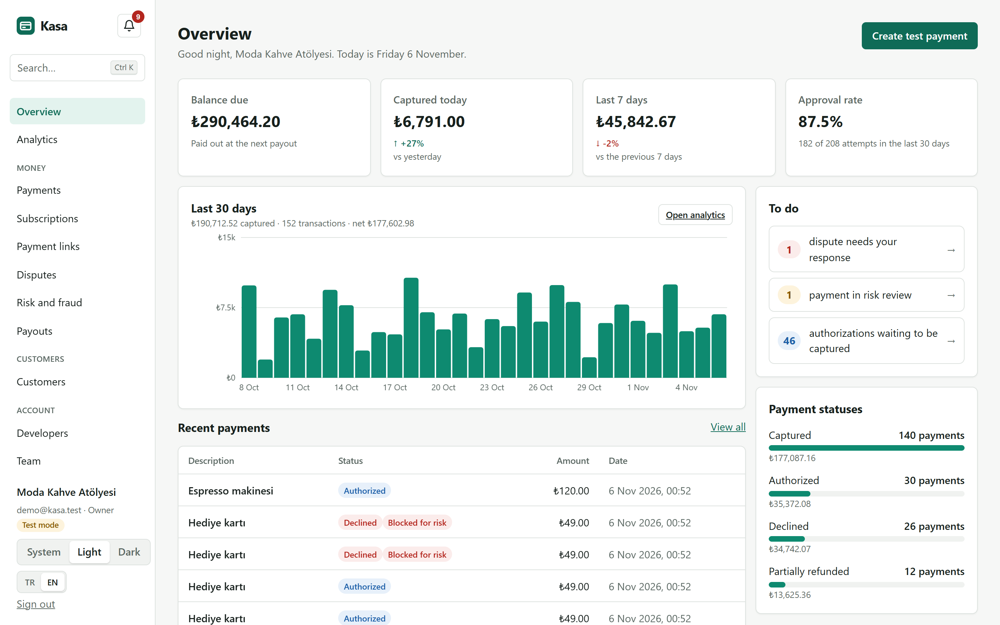
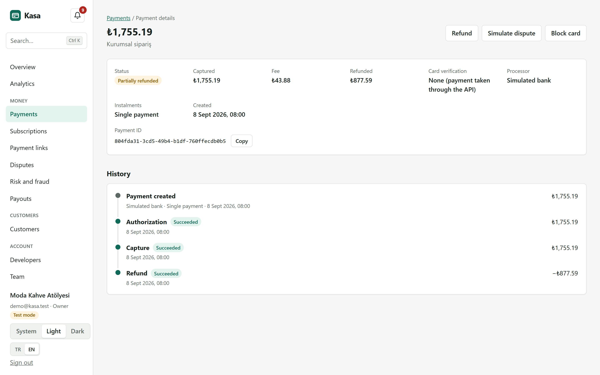
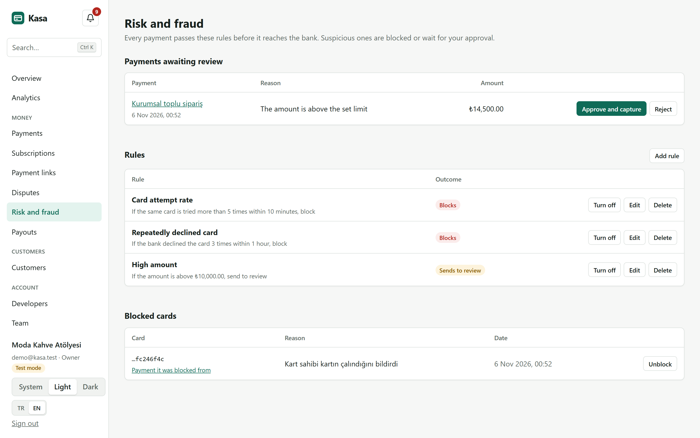
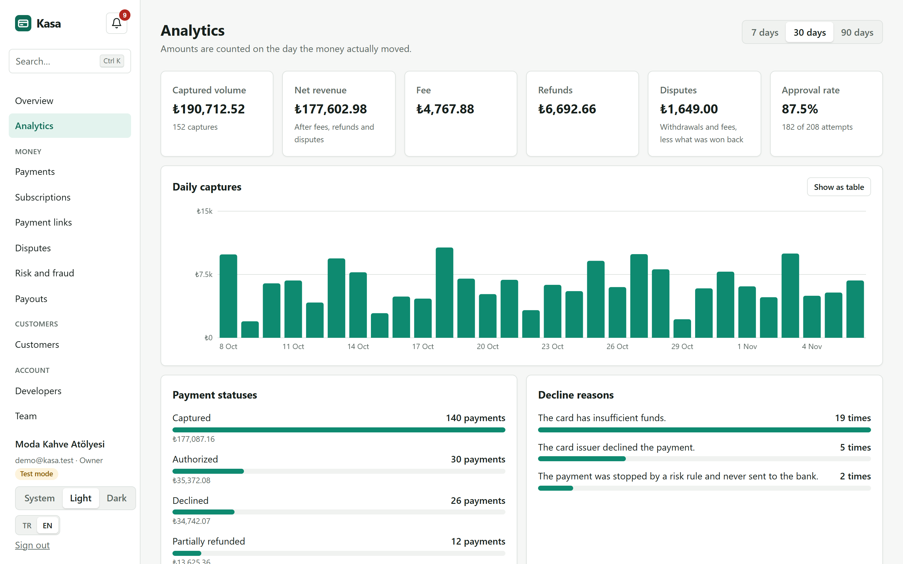
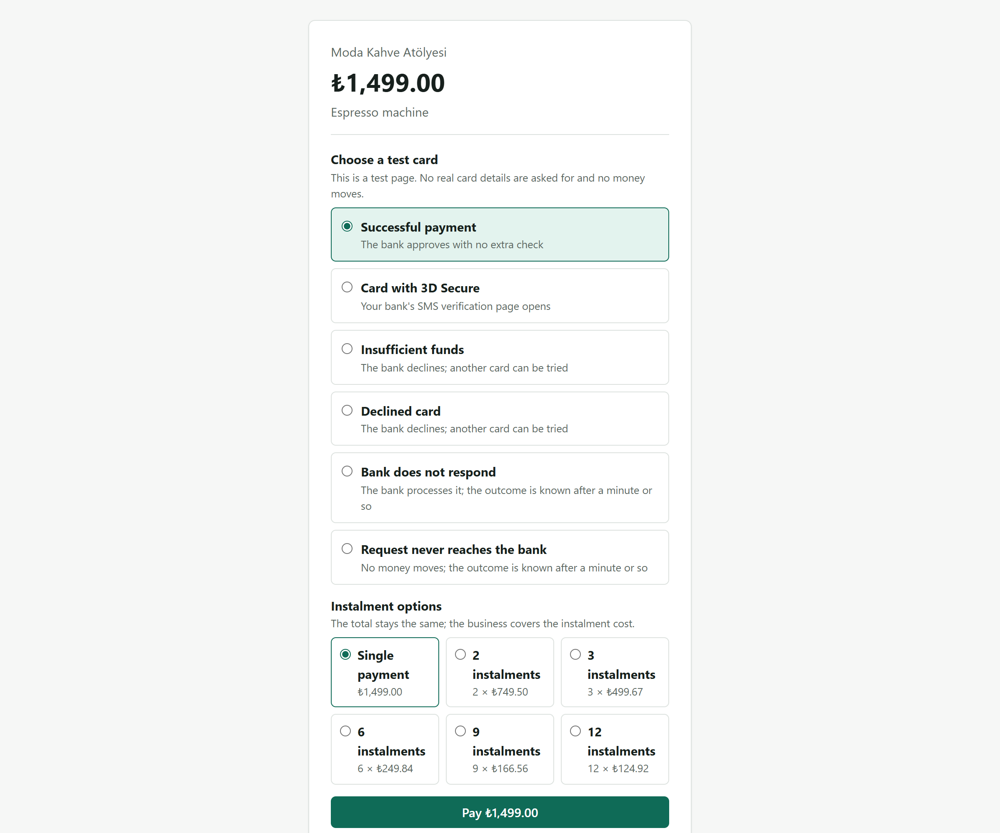
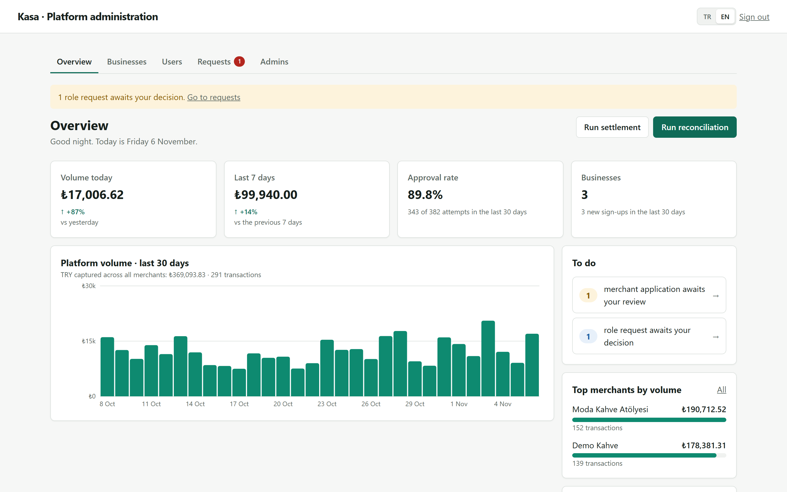
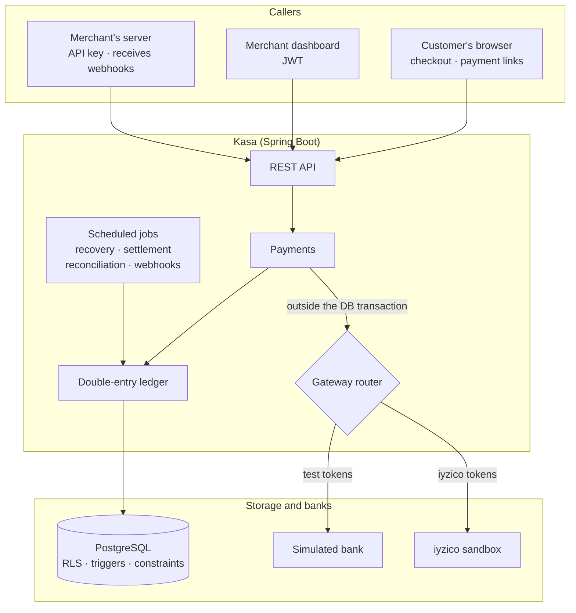
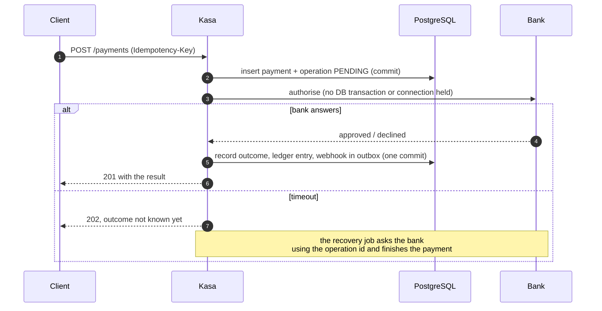

<div align="center">

# Kasa

**A multi-tenant payment platform: card payments, refunds, disputes, subscriptions and daily payouts,<br/>with every kuruş recorded in a double-entry ledger that the database itself keeps balanced.**

[](https://github.com/Fatihbk67/Kasa/actions/workflows/ci.yml)


[**Live demo**](https://kasa-rpb3.onrender.com) · [**Try it in one click**](https://kasa-rpb3.onrender.com/login) · [Architecture](#architecture) · [Engineering highlights](#engineering-highlights) · [Run it locally](#run-it-locally) · [Türkçe](README.tr.md)

<picture>
  <source media="(prefers-color-scheme: dark)" srcset="docs/screenshots/dashboard-dark.png">
  
</picture>

</div>

## What it is

Kasa does what a payment service provider does for an online business, from start to finish:

- A merchant signs up, applies with its legal details and IBAN, and is approved by a platform administrator.
- The merchant takes payments through an API key, a hosted checkout page or a shareable payment link.
- Payments are authorised, captured, voided or refunded.
- The merchant answers chargebacks, bills customers on subscriptions and screens payments with its own fraud rules.
- Each day, what the merchant earned is paid out and checked against the bank's statement.

It is a portfolio project and moves no real money. Payments go either to a **simulated bank** that can reproduce every failure on demand, or to **iyzico's real sandbox**, where card details are typed on iyzico's own page and never reach this server.

> **See it without signing up.** On the [sign-in page](https://kasa-rpb3.onrender.com/login), press **Try the demo**. It opens a read-only sample business with 45 days of payments, refunds, declines, disputes and a payout. The free server sleeps when idle, so the first visit can take about a minute.

## Engineering highlights

The interesting part of a payment system is what happens when things go wrong. Each of these behaviours is covered by integration tests against a real PostgreSQL.

| Problem | How Kasa handles it |
|---|---|
| **Money must never appear or vanish** | Every movement is a double-entry journal entry. A deferred constraint trigger rejects any transaction whose debits and credits differ, and the journal is append-only: no `UPDATE`, `DELETE` or `TRUNCATE`, even for a buggy code path. |
| **A retried request must not charge twice** | Every money-moving `POST` takes an `Idempotency-Key`. A uniqueness constraint plus a stored request hash makes a concurrent retry return the original result, and the same key with a different body is rejected. |
| **The bank times out mid-payment** | The operation is written as `PENDING` *before* the bank call, which happens outside the database transaction. A timeout is never guessed as success or failure: a recovery job asks the bank what actually happened and finishes the payment. |
| **One merchant's data must never leak to another** | Isolation is enforced by PostgreSQL row-level security, not by remembering a `WHERE tenant_id = ?`. The application connects as a role that cannot bypass RLS, and refuses to start if it could. |
| **Concurrent capture, void and refund** | Row locks and a "one pending operation per payment" constraint allow a single bank call at a time; status transitions are validated by a database trigger. |
| **Webhooks must not be lost, duplicated or abused** | A transactional outbox writes the event with the payment. Workers claim rows with `FOR UPDATE SKIP LOCKED` under a lease, retry with exponential back-off and sign each delivery with HMAC-SHA256 and a timestamp. Private, loopback and cloud-metadata addresses are refused at registration *and* on every send (SSRF). |
| **Paying a merchant twice** | A payout item can belong to only one live payout, with one payout per merchant per day, enforced by constraints so it holds even with several workers. A bank rejection returns the money and the items for the next run. |
| **Detecting drift from the bank** | Daily reconciliation compares the bank's statement with our operations and stored balances with the sum of the journal. It reports differences but never "fixes" them, since a person has to decide which side is right. |
| **Fraud** | Each merchant writes its own rules (velocity per card, repeated declines, amount limits, blocked cards). A rule can decline before the bank is ever called, or authorise and hold for review. A database trigger stops a held payment from being captured even if a code path forgets to check. 20 simultaneous payments with one card cannot slip past a limit of 5: the count is serialised by a per-card advisory lock. |
| **Tampering with the past** | The audit log is append-only and hash-chained, so even a superuser's edit or deletion is caught by `GET /audit-log/verify`. |
| **Revoking access now, not when a token expires** | JWTs cannot be recalled, so role and token version are read from the database on every request. A removed member is locked out on their next click; a password change ends other sessions. |

There are more, with the reasoning behind each, in [the Turkish README](README.tr.md#çözülen-mühendislik-problemleri): 3-D Secure with a signed bank response, instalments, subscription proration with `BigInteger`, month-end billing that does not drift, TOTP two-step sign-in, AES-GCM-encrypted secrets bound to their owner, an email outbox, CSV-injection-safe exports and more.

## Screenshots

| | |
|:---:|:---:|
|  |  |
| **Payment timeline.** Every bank operation, its outcome and amount. | **Risk and fraud.** A held payment, per-merchant rules, blocked cards. |
|  |  |
| **Analytics.** Net revenue agrees with the ledger to the kuruş. | **Hosted checkout.** Test cards for each failure mode, plus instalments. |



**Platform administration.** Volume across every merchant, applications and role requests to decide, top merchants and system health. The admin sees totals, never a merchant's individual payments.

The whole interface is available in Turkish and English, in light and dark themes, and works on a phone.

## Architecture

A modular monolith: one deployable, with packages that own their tables and talk through services. That is enough to show the hard problems without the operational cost of microservices.



### Taking a payment when the bank may not answer



### Who can do what

Merchants have three roles, and API keys a fourth, deliberately narrow set of rights. The platform administrator is a separate kind of account that sees totals, never a merchant's records.

| Action | Owner | Manager | Viewer | API key | Platform admin |
|---|:---:|:---:|:---:|:---:|:---:|
| View payments, analytics, payouts | ✅ | ✅ | ✅ | ✅ | — |
| Take payments, refund, answer disputes | ✅ | ✅ | — | ✅ | — |
| Risk rules, API keys, webhooks, audit log | ✅ | ✅ | — | — | — |
| Invite viewers | ✅ | ✅ | — | — | — |
| Invite managers, change roles, business details | ✅ | — | — | — | — |
| Approve merchants, run settlement and reconciliation | — | — | — | — | ✅ |

A leaked API key cannot create keys, redirect webhooks or add people. Every cell above was checked end to end against a running instance.

## Measured performance

These numbers come from one laptop (Intel i7-13650HX, 16 GB) running the load generator, the application and PostgreSQL at once. Each run lasted 30 seconds with a 10-connection pool and durable commits (`synchronous_commit=on`). A *flow* is an authorisation, a capture (which also writes the ledger and the webhook outbox) and a read.

| Scenario | Flows/s | Authorise p95 | Capture p95 | Unexpected responses |
|---|---:|---:|---:|---:|
| 50 concurrent clients, 20 merchants | 826 | 39 ms | 47 ms | 0 |
| 50 concurrent clients, 1 merchant | 712 | 45 ms | 55 ms | 0 |
| 1 merchant, after 20 merchants' data | 619 | 50 ms | 66 ms | 0 |

At the end of every run, each merchant's balance matched the load generator's independent tally to the kuruş.

**Finding the single-merchant bottleneck.** All of one merchant's payments update the same balance rows. `pg_stat_statements` showed the time was going into waiting for the `FOR UPDATE` lock on those rows, which was taken at the start of the transaction and held through every later write. Now the balance changes last, in one conditional `UPDATE` that also enforces the no-overdraft rule, and nothing but the commit follows it. Measured before and after on the same day and machine, this raised single-merchant throughput by **38%** (514 → 712 flows/s) on a clean database and by **43%** (432 → 619 flows/s) on a full one. With 20 merchants the change makes no difference, because their payments do not wait on each other's locks.

These numbers describe this machine, not production capacity: the bank is simulated, so there is no network latency. To reproduce them, start the server and run:

```bash
java -Djdk.net.unixdomain.tmpdir=backend/target load-test/LoadTest.java http://localhost:8080 50 30 20
```

## Tech stack

| | |
|---|---|
| **Backend** | Java 21, Spring Boot 4, Spring Security (JWT resource server), JDBC with hand-written SQL, Flyway (21 migrations) |
| **Database** | PostgreSQL 18: row-level security, triggers, deferred constraints, `SKIP LOCKED` queues, advisory locks |
| **Frontend** | React 19, TypeScript, Vite, React Router; no UI library, accessible native dialogs, a hand-built chart, Turkish/English i18n |
| **Integrations** | iyzico sandbox (Checkout Form, signed `IYZWSv2` requests), Brevo transactional email, Google Identity Services |
| **Operations** | Docker, GitHub Actions (test, build, image), Render + Neon, Prometheus metrics and a provisioned Grafana dashboard |
| **Testing** | 500+ backend integration tests on an embedded PostgreSQL (no Docker needed), concurrency tests with real threads, Vitest for the frontend |

## Run it locally

You need Java 21, Maven and Node.js. No Docker and no database installation are required: the backend starts a throwaway PostgreSQL and fills it with 60 days of sample data.

```bash
cd backend
mvn spring-boot:test-run
```

```bash
cd frontend
npm install
npm run dev
```

Open <http://localhost:5173> and sign in as `demo@kasa.test` with the password `demo-parola-12345`. These credentials exist only in the local demo. The admin panel is at `/admin`; open it with the local admin key `local-dev-admin-token`.

Something worth trying: press **Create test payment**, then choose **Bank does not respond**. The page waits, and within about a minute and a half the recovery job asks the bank and the page updates by itself.

<details>
<summary><b>With Docker</b>: PostgreSQL, the app, Prometheus and Grafana</summary>

Copy `.env.example` to `.env`, replace every value with a long random string, then run:

```bash
docker compose up --build
```

The app is at <http://localhost:8080>, Prometheus at <http://localhost:9090> and Grafana at <http://localhost:3000> (user `admin`, with the password from `.env`; the "Kasa" dashboard is ready). This setup starts empty, like production. Sign up, and you will find the email verification link with `docker compose logs app`. Fill in the business application, then approve it at `/admin` with `KASA_ADMIN_TOKEN` from `.env`.

</details>

<details>
<summary><b>Tests</b></summary>

```bash
cd backend && mvn test        # integration tests on a real, embedded PostgreSQL
cd frontend && npm test       # Vitest
```

</details>

<details>
<summary><b>Deploying</b></summary>

One Docker image serves both the API and the interface. `render.yaml` is a ready Render blueprint, and the database can be any managed PostgreSQL, such as Neon. The application connects as a restricted role (`kasa_app`), and migrations run as the schema owner. The full checklist, including email, iyzico and Google sign-in, is in [the Turkish README](README.tr.md#yayına-alma).

</details>

## API at a glance

```bash
curl -X POST https://kasa-rpb3.onrender.com/api/v1/payments \
  -H "X-Api-Key: $KASA_API_KEY" \
  -H "Idempotency-Key: $(uuidgen)" \
  -H "Content-Type: application/json" \
  -d '{"amount": 14990, "currency": "TRY", "cardToken": "tok_success", "description": "Order #1042"}'
```

- Amounts are in minor units (kuruş).
- A `201` response carries the outcome. A `202` means the bank has not answered yet; read the payment again later.
- Test tokens choose the bank's behaviour:
  - `tok_success` succeeds.
  - `tok_declined` is declined.
  - `tok_timeout_processed` succeeds at the bank, but the answer never arrives.
  - `tok_timeout_lost` never reaches the bank.

Webhooks are signed as `X-Kasa-Signature: t=<unix time>,v1=<hex>`, an HMAC-SHA256 of `<t>.<raw body>`. Delivery is at least once, so deduplicate with `X-Kasa-Event-Id`.

There are over 120 endpoints in all, covering payments, refunds, disputes, subscriptions, payment links, customers, payouts, risk, team, audit and administration. An endpoint table with authentication and query parameters is in [the Turkish README](README.tr.md#api).

## Known limitations

They are listed honestly, because knowing them is part of the design.

- **Rate limits are per instance.** Several servers would need a shared store such as Redis.
- **The audit chain proves edits but not truncation of the newest rows.** That needs the latest hash anchored outside the database.
- **Secrets are encrypted with a key from the environment.** A real deployment would use a KMS.
- **The free hosting plan sleeps.** While it sleeps, scheduled settlement and reconciliation do not run reliably.
- **No trials, coupons, taxes or metered billing for subscriptions.** There is one dispute per payment, with no pre-arbitration stage.

## Project layout

```text
backend/src/main/java/com/kasa/
  ledger/          double-entry accounts, journal and balances
  payment/         payment state machine, idempotency, recovery
  bank/  iyzico/   simulated bank with 3-D Secure, iyzico sandbox, gateway router
  checkout/        hosted checkout and payment links
  settlement/  reconciliation/   daily payouts and bank statement matching
  dispute/  billing/  risk/      chargebacks, subscriptions, fraud rules
  webhook/  mail/  notification/ outboxes and in-app notifications
  auth/  security/  team/  admin/  tenant/  audit/   identity, roles, RLS, audit chain
  demo/            the read-only sample business behind "Try the demo"
backend/src/main/resources/db/migration/   21 Flyway migrations
frontend/src/                               React app: dashboard, checkout, admin
load-test/LoadTest.java                     single-file load generator
infra/                                      Prometheus and Grafana provisioning
```

---

<div align="center">

Built by [Fatih](https://github.com/Fatihbk67), a software engineering student. Questions and feedback are welcome by email at fatihbk67@gmail.com or through [an issue](https://github.com/Fatihbk67/Kasa/issues).

</div>
