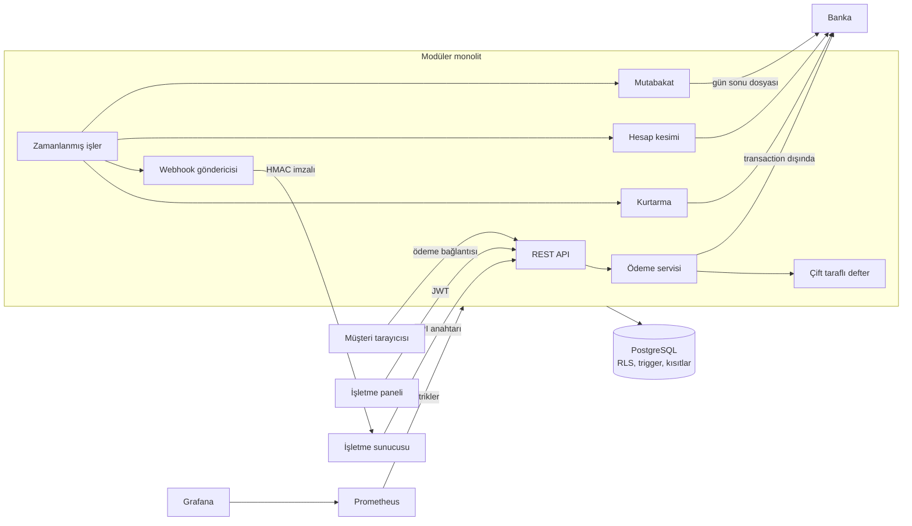

# Kasa

[](https://github.com/Fatihbk67/Kasa/actions/workflows/ci.yml)

Çok kiracılı (multi-tenant) ödeme altyapısı platformu. İşletmeler API anahtarıyla sisteme bağlanır, ödeme alır, iade yapar ve kazançlarını çeker. Her para hareketi çift taraflı muhasebe defterine (double-entry ledger) yazılır.

> Eğitim ve portföy projesidir. Gerçek kart verisi işlemez; banka tarafı simüle edilir.

## Mimari



## Ölçülen performans

Tek dizüstü bilgisayarda (Intel i7-13650HX, 16 GB RAM) yük istemcisi, uygulama ve PostgreSQL aynı makinede çalışırken 30 saniyelik ölçümler. Bağlantı havuzu varsayılan 10 bağlantıdır, kalıcı commit (`synchronous_commit=on`) açıktır. Bir akış provizyon, tahsilat ve okumadan oluşur; tahsilat defter kaydı ve webhook kuyruğunu da yazar.

| Senaryo | Akış/sn | Provizyon p95 | Tahsilat p95 | Beklenmeyen yanıt |
|---|---|---:|---:|---:|
| 50 eşzamanlı istemci, 20 işletme | 1.116 | 26 ms | 29 ms | 0 |
| 50 eşzamanlı istemci, tek işletme | 581 | 45 ms | 65 ms | 0 |

Tek işletmede verimin düşmesi beklenen bir durumdur: aynı bakiye satırı kilitlendiği için tahsilatlar sıraya girer. Bu, tutarlılığın bilinçli bedelidir.

Ölçüm sonunda her işletmenin bakiyesi istemcinin bağımsız hesabıyla kuruşu kuruşuna eşleşti. Mutabakat 50.982 banka satırının tamamını farksız eşleştirdi.

Sınırlar: Banka simüle edildiği için gerçek ağ gecikmesi yoktur. Rakamlar üretim kapasitesi değildir; sistemin bu makinedeki davranışını gösterir. Yeniden üretmek için sunucu çalışırken:

```bash
java -Djdk.net.unixdomain.tmpdir=backend/target load-test/LoadTest.java http://localhost:8080 50 30 20
```

## Çözülen mühendislik problemleri

- **Para kaybolmaz:** Her kayıtta borç ve alacak toplamı eşittir. Bu kural yalnızca uygulamada değil, veritabanında da zorunludur.
- **Geçmiş değiştirilemez:** Defter kayıtları güncellenemez ve silinemez. Hatalar ters kayıtla düzeltilir.
- **Çift işlem olmaz:** Aynı istek eşzamanlı olarak tekrar gönderilse bile idempotency anahtarı sayesinde bir kez işlenir.
- **Bakiye aşılamaz:** Eşzamanlı para çekme istekleri satır kilitleriyle sıraya girer. Hesaplar sabit sırada kilitlendiği için deadlock oluşmaz.
- **Tutarsızlık yakalanır:** Mutabakat sorgusu, saklanan bakiyeleri defter kayıtlarının toplamıyla karşılaştırır.
- **Kiracılar birbirinin verisini göremez:** İzolasyonu PostgreSQL Row Level Security uygular. Bir sorguda `tenant_id` filtresi unutulsa bile başka işletmenin verisi dönmez; kiracı bağlanmamışsa hiçbir satır görünmez.
- **Uygulama en az yetkiyle çalışır:** `kasa_app` rolü defter kayıtlarını değiştiremez. Bu rol RLS'i aşabilecek yetkilere sahipse uygulama hiç başlamaz.
- **Kimlik bilgileri korunur:** Parolalar BCrypt ile saklanır. API anahtarlarının yalnızca SHA-256 özeti tutulur ve anahtarın tamamı bir kez gösterilir. Sızan bir API anahtarı yeni anahtar üretemez.
- **Banka yanıt vermese de para kaybolmaz:** Her banka çağrısından önce işlem `PENDING` olarak kaydedilir. Zaman aşımında sonuç tahmin edilmez; kurtarma işi bankaya sorup işlemi sonuçlandırır.
- **Banka beklenirken veritabanı bağlantısı tutulmaz:** Akış üç adımdır: işlemi kaydet, transaction dışında bankayı çağır, sonucu kaydet.
- **Capture ve void yarışamaz:** Satır kilidi ve "ödeme başına tek `PENDING` işlem" kısıtı, aynı anda tek banka çağrısına izin verir.
- **Geçersiz durum geçişi imkânsızdır:** Örneğin `CAPTURED` bir ödeme yeniden `AUTHORIZED` olamaz. Bu kuralı veritabanı trigger'ı uygular.
- **Kart numarası sisteme giremez:** API yalnızca token kabul eder.
- **Bildirim kaybolmaz:** Webhook, ödeme sonucuyla aynı transaction'da kuyruğa yazılır (transactional outbox). Teslim edilemezse üstel geri çekilmeyle yeniden denenir.
- **Birden çok sunucu aynı bildirimi almaz:** `FOR UPDATE SKIP LOCKED` ile her gönderici farklı satırları alır. Gönderici çökerse lease süresi dolunca teslimat başkası tarafından devralınır.
- **Sahte bildirim ayırt edilir:** Her webhook, zaman damgasıyla birlikte HMAC-SHA256 ile imzalanır.
- **Webhook URL'si iç ağa saldırı aracı olamaz (SSRF):** Özel ağ, loopback ve bulut metadata adresleri hem kayıtta hem her gönderimde engellenir; yönlendirmeler izlenmez.
- **İşletmeye iki kez ödeme yapılmaz:** Bir işlem yalnızca tek bir canlı toplu ödemeye girebilir ve işletme başına günde tek ödeme oluşur. Bu kuralları veritabanı kısıtları uygular, iş aynı anda birden çok sunucuda çalışsa da geçerlidir.
- **Reddedilen ödemede para kaybolmaz:** Para önce "yolda" hesabına alınır. Banka reddederse tutar ve kalemler geri döner, sonraki çalıştırma yeniden dener.
- **Parola denemeleri yavaşlatılır:** Giriş, kayıt ve herkese açık ödeme uçlarında istek sınırı vardır; aşılınca `429` ve `Retry-After` döner. Sayaçlar sunucu başınadır, birden çok sunucuda ortak depo gerekir.
- **Sistem gözlemlenebilir:** Sonucu bilinmeyen banka işlemleri, webhook kuyruğu ve mutabakat farkları Prometheus metriği olarak yayımlanır. Metrik ucu yalnızca yönetici token'ıyla açılır.
- **Bankayla farklar yakalanır:** Günlük mutabakat banka dosyasını kayıtlarımızla karşılaştırır. Farkları raporlar ama düzeltmez, çünkü hangi tarafın doğru olduğuna insan karar vermelidir.

## Teknolojiler

**Backend:** Java 21, Spring Boot 4, Spring Security, JWT, PostgreSQL 18, Flyway, JUnit, embedded PostgreSQL. Mimari modüler monolittir.

**Frontend:** React 19, TypeScript, Vite, React Router, Vitest. İşletme paneli ve herkese açık ödeme sayfasından oluşur.

## Testleri çalıştırma

Testler gerçek bir PostgreSQL üzerinde çalışır ve Docker gerektirmez. İlk çalıştırmada bağımlılıkların inmesi birkaç dakikadan uzun sürebilir.

```bash
cd backend
mvn test
```

```bash
cd frontend
npm install
npm test
```

## Hızlı başlangıç (Docker gerekmez)

Java, Maven ve Node.js yeterlidir. Backend geçici bir PostgreSQL başlatır ve demo verisi yükler; her başlatmada veriler sıfırlanır.

İlk terminalde:

```bash
cd backend
mvn spring-boot:test-run
```

İkinci terminalde:

```bash
cd frontend
npm install
npm run dev
```

Ardından `http://localhost:5173` adresini açın. Demo hesabı `demo@kasa.test`, parolası `demo-parola-12345`'tir. Bu bilgiler yalnızca yerel demo içindir. Yönetici API'sinin yerel token'ı `local-dev-admin-token`'dır.

Sunucuyu kapatırken terminalde `Ctrl+C` kullanın. Zorla sonlandırılırsa geçici PostgreSQL süreçleri açık kalabilir.

Denemeye değer akış: **Test ödemesi oluştur** ile ödeme sayfasını açın ve "Banka yanıt vermiyor" kartını seçin. Sayfa bekleme durumuna geçer, yaklaşık bir buçuk dakika içinde kurtarma işi bankaya sorar ve sonuç kendiliğinden güncellenir. Ardından panelden ödemeyi tahsil edip iade edin.

## Docker ile çalıştırma

Bu yol henüz çalıştırılarak denenmemiştir. `.env.example` dosyasını `.env` olarak kopyalayıp değerleri değiştirin, ardından:

```bash
docker compose up --build
```

Uygulama `http://localhost:8080`, Prometheus `http://localhost:9090`, Grafana `http://localhost:3000` adresindedir. Grafana'da "Kasa" panosu hazır gelir.

## Yayına alma

Tek bir Docker imajı API ile arayüzü birlikte sunar. Depodaki `render.yaml`, Render için hazırdır; veritabanı olarak Neon gibi yönetilen bir PostgreSQL kullanılır.

1. Neon'da Frankfurt bölgesinde bir proje açın. SQL editöründe kendi güçlü parolanızla uygulama rolünü oluşturun:

   ```sql
   CREATE ROLE kasa_app LOGIN PASSWORD 'kendi-guclu-parolaniz';
   ```

2. Render'da **New → Blueprint** ile bu depoyu bağlayın ve istenen değerleri girin:

   | Değişken | Değer |
   |---|---|
   | `KASA_DB_URL` | `jdbc:postgresql://<neon-host>/<veritabanı>?sslmode=require` (host adında `-pooler` olmayan doğrudan bağlantı) |
   | `KASA_DB_APP_PASSWORD` | 1. adımdaki parola |
   | `KASA_DB_OWNER_USER` | Neon'un sahip rolü, örneğin `neondb_owner` |
   | `KASA_DB_OWNER_PASSWORD` | Sahip rolünün parolası |

   `KASA_JWT_SECRET` ve `KASA_ADMIN_TOKEN` otomatik üretilir. Uygulama rolü tablo sahibi veya süper kullanıcı olursa uygulama bilerek başlamaz.

Başka bir platformda aynı değişkenlere ek olarak `KASA_DB_APP_USER=kasa_app` tanımlayın. Ters proxy arkasında `KASA_FORWARD_HEADERS=native` gerekir; aksi halde tüm istemciler tek adres sayılır ve istek sınırı herkesi birlikte engeller.

**Ücretsiz planda bilinmesi gerekenler:** Sunucu 15 dakika istek almazsa uyur ve ilk istekte yeniden başlaması bir dakikadan uzun sürebilir. Uyurken zamanlanmış işler çalışmaz, bu yüzden günlük hesap kesimi ve mutabakat güvenilir biçimde tetiklenmez. Simüle banka kayıtları her yeniden başlatmada silinir. Bu nedenle eski provizyonlar `unknown_authorization` hatası alır ve mutabakat eski işlemleri `MISSING_IN_BANK` olarak gösterir. Bunlar demo sınırıdır; gerçek bir bankada oluşmaz.

## API

| Metot | Yol | Kimlik doğrulama | Açıklama |
|---|---|---|---|
| POST | `/api/v1/auth/register` | Yok | İşletme ve kullanıcı oluşturur, JWT döner |
| POST | `/api/v1/auth/login` | Yok | JWT döner |
| GET | `/api/v1/tenant` | JWT veya `X-Api-Key` | Geçerli işletmeyi döner |
| POST | `/api/v1/api-keys` | JWT | API anahtarı üretir |
| GET | `/api/v1/api-keys` | JWT | Anahtarları gizli kısımları olmadan listeler |
| DELETE | `/api/v1/api-keys/{id}` | JWT | Anahtarı iptal eder |
| POST | `/api/v1/payments` | JWT veya `X-Api-Key` | Ödeme oluşturur ve provizyon alır |
| GET | `/api/v1/payments` | JWT veya `X-Api-Key` | Ödemeleri listeler (`status`, `limit`, `before`) |
| GET | `/api/v1/payments/{id}` | JWT veya `X-Api-Key` | Ödemeyi işlem geçmişiyle döner |
| POST | `/api/v1/payments/{id}/capture` | JWT veya `X-Api-Key` | Tutarın tamamını veya bir kısmını tahsil eder |
| POST | `/api/v1/payments/{id}/void` | JWT veya `X-Api-Key` | Provizyonu iptal eder |
| POST | `/api/v1/payments/{id}/refunds` | JWT veya `X-Api-Key` | Tam veya kısmi iade yapar |
| POST | `/api/v1/webhook-endpoints` | JWT | Endpoint ekler, imza anahtarını bir kez gösterir |
| GET | `/api/v1/webhook-endpoints` | JWT | Endpoint'leri listeler |
| DELETE | `/api/v1/webhook-endpoints/{id}` | JWT | Devre dışı bırakır, bekleyen teslimatları iptal eder |
| GET | `/api/v1/webhook-endpoints/{id}/deliveries` | JWT | Son teslimatları gösterir |
| POST | `/api/v1/webhook-endpoints/deliveries/{id}/retry` | JWT | Başarısız teslimatı yeniden sıraya alır |
| GET | `/api/v1/balances` | JWT veya `X-Api-Key` | Ödenecek ve yoldaki bakiyeyi döner |
| POST | `/api/v1/checkout-sessions` | JWT veya `X-Api-Key` | 30 dakikalık ödeme bağlantısı oluşturur |
| GET | `/api/v1/public/checkout/{id}` | Yok | Ödeme sayfası bilgilerini döner |
| POST | `/api/v1/public/checkout/{id}/pay` | Yok | Test kartıyla ödeme yapar |
| GET | `/api/v1/payouts` | JWT veya `X-Api-Key` | Toplu ödemeleri listeler |
| GET | `/api/v1/payouts/{id}` | JWT veya `X-Api-Key` | Toplu ödemeyi kalemleriyle döner |
| POST | `/api/v1/admin/settlements/run` | `X-Admin-Token` | Hesap kesimini hemen çalıştırır |
| POST | `/api/v1/admin/reconciliation/runs?date=` | `X-Admin-Token` | Tarih için mutabakat çalıştırır |
| GET | `/api/v1/admin/reconciliation/runs` | `X-Admin-Token` | Mutabakat geçmişini listeler |
| GET | `/api/v1/admin/reconciliation/runs/{id}` | `X-Admin-Token` | Çalıştırmayı farklarıyla döner |
| GET | `/actuator/health` | Yok | Sağlık kontrolü |

Ödeme endpoint'lerindeki tüm `POST` istekleri `Idempotency-Key` başlığı ister. `202` yanıtı, bankadan henüz sonuç alınamadığını gösterir; ödemeyi daha sonra sorgulamak gerekir.

## Ödeme durumları

```text
PENDING ──> AUTHORIZED ──> CAPTURED ──> PARTIALLY_REFUNDED ──> REFUNDED
   │             │             └──────────────────────────────────^
   ├──> DECLINED └──> VOIDED
   └──> FAILED
```

## Webhook'lar

Olaylar: `payment.authorized`, `payment.declined`, `payment.failed`, `payment.captured`, `payment.voided`, `payment.refunded`, `payment.operation_failed`, `payout.paid`, `payout.failed`.

Teslimat **en az bir kez** garantilidir ve sıra garantisi yoktur. Alıcı `X-Kasa-Event-Id` ile tekrarları ayıklamalı, sıralama için gövdedeki `createdAt` alanını kullanmalıdır. 2xx dışındaki her yanıt başarısız sayılır; 8 denemeden sonra teslimat `FAILED` olur ve elle yeniden denenebilir.

İmza `X-Kasa-Signature: t=<unix-zaman>,v1=<hex>` biçimindedir. Alıcı, `<t>.<ham gövde>` metninin imza anahtarıyla HMAC-SHA256 değerini hesaplayıp `v1` ile sabit zamanlı karşılaştırmalı, eski `t` değerlerini de reddetmelidir.

Yerelde `localhost` hedefine göndermek için `KASA_WEBHOOKS_ALLOW_INSECURE_TARGETS=true` tanımlanır. Bu ayar canlıda kapalı kalmalıdır.

**Bilinen sınırlar:** İmza anahtarları veritabanında şifrelenmeden tutulur, çünkü imzalarken özgün değer gerekir; gerçek sistemde KMS gerekir. URL kontrolü ile bağlantı arasında DNS yanıtı değişebilir; bunu tamamen kapatmak için çıkış proxy'si gerekir.

## Hesap kesimi ve mutabakat

**Hesap kesimi** her gün 02:00 UTC'de çalışır. Dünün başlangıcından önce tamamlanan tahsilat ve iadeleri işletme ve para birimi bazında toplar. Tahsilatlar ücret düşülerek eklenir, iadeler çıkarılır; işlem ücreti iade edilmez. Net tutar sıfır veya negatifse kalemler sonraki güne devreder.

Defter kayıtları şöyledir:

| Adım | Borç | Alacak |
|---|---|---|
| Ödeme oluşturuldu | `merchant_payable` | `payout_in_transit` |
| Banka ödedi | `payout_in_transit` | `psp_clearing` |
| Banka reddetti | `payout_in_transit` | `merchant_payable` |

**Mutabakat** her gün 03:00 UTC'de bir önceki günün banka dosyasını karşılaştırır. Bozuk bir dosya kısmen işlenmez, tamamen reddedilir. Gece yarısına yakın işlemler komşu günlere yazılabildiği için `MISSING_IN_BANK` kontrolü önceki ve sonraki günün dosyalarına da bakar.

| Fark | Anlamı |
|---|---|
| `MISSING_IN_BANK` | Bizde var, bankada yok |
| `MISSING_IN_KASA` | Bankada var, bizde yok |
| `AMOUNT_MISMATCH` | Tutar farklı |
| `DETAILS_MISMATCH` | İşlem türü veya para birimi farklı |
| `DUPLICATE_IN_BANK` | Aynı referans dosyada birden çok kez geçiyor |
| `LEDGER_DRIFT` | Saklanan bakiye defter kayıtlarının toplamıyla uyuşmuyor |

Yönetici API'si `KASA_ADMIN_TOKEN` ile açılır; tanımlı değilse tüm istekleri reddeder. Bu token kiracıya bağlı olmadığından işletme verilerine erişim sağlamaz.

**Bilinen sınırlar:** Yönetici erişimi tek bir paylaşılan token'dır; gerçek sistemde kişiye özel hesap ve denetim kaydı gerekir. Dakika dakika canlı bakiye hesabı yerine günlük toplu çalışma tercih edilmiştir.

## Test kart token'ları

Banka simüle edilir; davranışı token belirler. Böylece her hata senaryosu istenildiği an tekrar üretilebilir.

| Token | Davranış |
|---|---|
| `tok_success` | Her işlem başarılı |
| `tok_declined`, `tok_insufficient_funds` | Provizyon reddedilir |
| `tok_timeout_processed` | Banka işlemi yapar ama yanıt gelmez; kurtarma işi `AUTHORIZED` yapar |
| `tok_timeout_lost` | İstek bankaya ulaşmaz; kurtarma işi `FAILED` yapar |
| `tok_capture_declined` | Provizyon başarılı, capture reddedilir |
| `tok_capture_timeout`, `tok_refund_timeout` | İşlem bankada yapılır ama yanıt gelmez; kurtarma işi tamamlar |

## Yol haritası

- [x] **Defter çekirdeği:** Hesaplar, çift taraflı kayıtlar, idempotency, mutabakat
- [x] **İşletme ve kimlik doğrulama:** Kayıt, JWT, API anahtarları, PostgreSQL Row Level Security
- [x] **Ödeme akışı:** Durum makinesi (authorize, capture, void, refund), simüle banka, hata senaryoları
- [x] **Webhook:** Transactional outbox, `FOR UPDATE SKIP LOCKED`, üstel geri çekilmeli yeniden deneme, HMAC imzası
- [x] **Hesap kesimi ve mutabakat:** İşletmelere toplu ödeme, banka dosyasıyla karşılaştırma, zamanlanmış işler
- [x] **Frontend:** Ödeme sayfası ve işletme paneli (React, TypeScript)
- [x] **Vitrin:** İstek sınırı, yük testi, Prometheus metrikleri, Grafana panosu, GitHub Actions, Docker imajı
- [ ] **Canlı demo:** Uygulamanın herkese açık bir adreste yayınlanması
